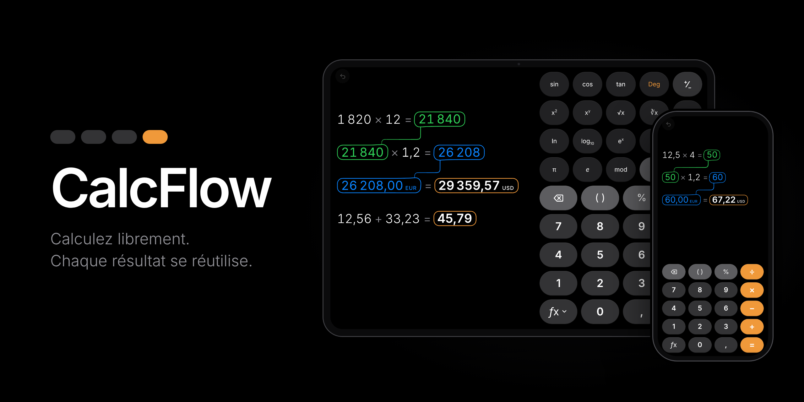

# CalcFlow

Calculatrice à feuille libre, dans l'esprit de Tydlig, à l'allure de la Calculatrice d'Apple. Chaque résultat devient une cellule que l'on réutilise : les calculs restent liés et se mettent à jour d'eux-mêmes.

**Démo :** https://ninjathune-human.github.io/calcflow/

## L'essentiel

- **Feuille libre** : on pose un calcul où l'on veut, le résultat apparaît avec `=`.
- **Cellules liées** : on glisse un résultat dans un autre calcul. Les liens prennent la couleur de la cellule ; modifier la source recalcule toute la chaîne, chiffre après chiffre.
- **Calcul entre cellules** : on sélectionne une cellule, on appuie sur une opération, on approche une seconde cellule, puis `=`.
- **Devises et cryptos** : un appui long sur une cellule crée sa conversion, liée à la source. Taux en direct, avec un jeu de taux intégré hors ligne.
- **Partout** : clavier sur 40 % de l'écran sur iPhone et sur un tiers sur iPad, fonctions scientifiques dépliables (touche fx), clavier à droite en paysage, clavier physique sur ordinateur. Tactile, stylet et souris.
- **Sauvegarde automatique** dans le navigateur, annulation pas à pas.

## Gestes

| Geste | Effet |
| --- | --- |
| Toucher la feuille | Nouveau calcul à cet endroit |
| Toucher une cellule | Sélection |
| Glisser une cellule | Réutiliser la valeur, avec un lien |
| Appui long sur une cellule | Conversion en devise ou en crypto |
| Cellule sélectionnée, puis une opération | Calcul qui part de cette cellule |
| Nombre sélectionné, puis ⌫ | Modifier le nombre dans sa cellule |
| ⌫ : toucher, maintenir, glisser à gauche | Effacer un caractère, la ligne, toute la feuille |

## Utilisation

Un seul fichier, `index.html`, sans installation ni dépendance : il s'ouvre dans n'importe quel navigateur.

Mise en ligne avec GitHub Pages : **Settings › Pages › Deploy from a branch**, branche `main`, dossier `/ (root)`.

Sur iPhone et iPad, **Partager › Sur l'écran d'accueil** l'ouvre en plein écran, comme une app.

## Technique

HTML, CSS et JavaScript natifs. Police Inter (Google Fonts, repli sur la police système). Taux de change : API publique Coinbase.
